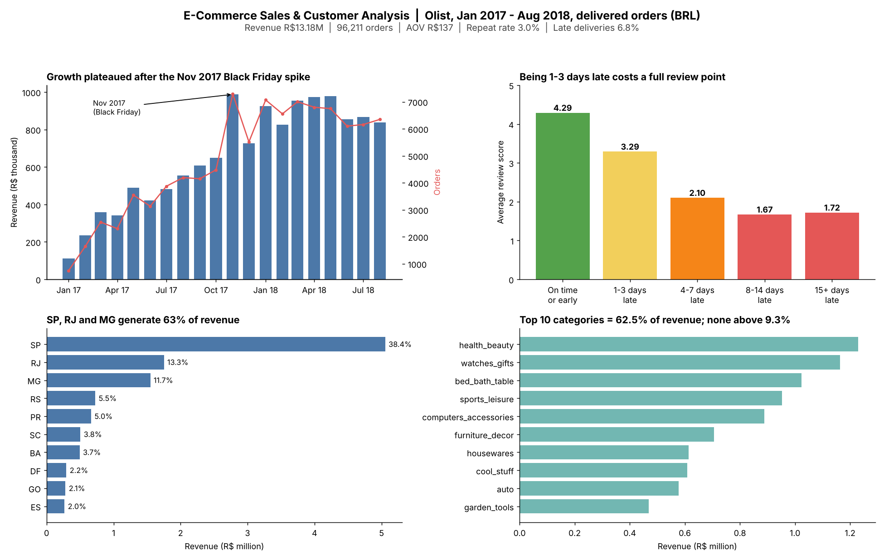
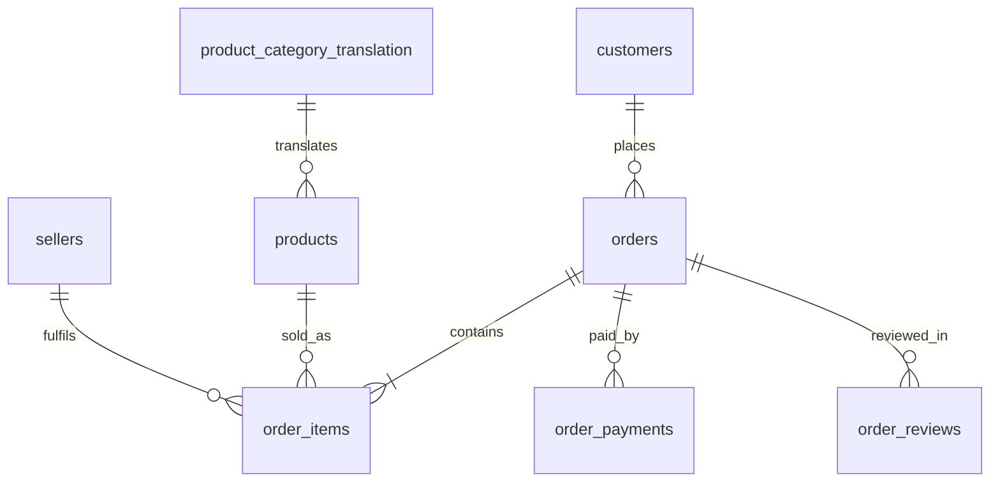

# E-Commerce Sales & Customer Analysis (SQL)

End-to-end SQL analysis of **96,211 delivered orders (R$13.18M revenue)** from the Olist Brazilian marketplace, Jan 2017 to Aug 2018. The project covers data-quality auditing, a reusable cleaned view layer, and analysis of sales, products, customers and operations. Each section ends with business insights and recommendations.

**Stack:** PostgreSQL · SQL (CTEs, window functions, views) · Excel/CSV exports · Git

## Dashboard

The dashboard summarizes monthly revenue and orders, customer ratings by delivery
lateness, revenue by state, and revenue by product category.



The chart above is a static preview. The CSV exports below are available for
exploration or for building an interactive dashboard in Excel:

| Export | Contents |
|---|---|
| [Monthly sales](outputs/monthly_sales.csv) | Monthly revenue, order count, average order value, and month-over-month change |
| [State sales](outputs/state_sales.csv) | Revenue, orders, delivery time, late rate, and review score by state |
| [Category Pareto](outputs/category_pareto.csv) | Category units, revenue, and cumulative revenue share |
| [Category scorecard](outputs/category_scorecard.csv) | Category revenue, review score, late rate, and delivery time |
| [Lateness vs. reviews](outputs/lateness_vs_reviews.csv) | Review outcomes grouped by days late |
| [Monthly delivery](outputs/monthly_delivery.csv) | Monthly delivery time and late-delivery rate |
| [RFM segments](outputs/rfm_segments.csv) | Customer counts, revenue, and recency by RFM segment |

## Key findings

| Area | Finding |
|---|---|
| Growth | Growth was volume-led (AOV stayed R$125-149; 1.14 items per order). Revenue plateaued at R$0.83-0.98M/month after Jan 2018. |
| Black Friday | 24 Nov 2017 produced 1,147 orders, about 4.7x a normal November day. 2018 settled at a higher baseline. |
| Geography | SP, RJ and MG generate **63.4%** of revenue. SP alone is 38.4%. |
| Products | 18 of 74 categories produce 80% of revenue. No category exceeds 9.3% and no product exceeds 0.5%. |
| Customers | **97.0% buy only once.** The true repeat rate is about 2.1% after removing same-day second orders. Cohort retention is below 1% at months 1, 3 and 6. |
| Customer value | The top 10% of customers hold 41.1% of revenue. Value comes from basket size, not loyalty. |
| Operations | 6.8% of orders arrive late. Average review score falls from **4.29 (on time) to 3.29 (1-3 days late)** and about 1.7 (8+ days late). |
| Stress periods | Late rate peaked at 12.4% (Nov 2017), 14.1% (Feb 2018) and 19.0% (Mar 2018), against about 3-4% in normal months. |
| Hotspots | Rio de Janeiro has a 12.1% late rate (SP: 4.5%) and a 3.97 score (SP: 4.25). |

**Recommendations**
- Trigger a post-purchase campaign within 30 days for first-time, high-basket buyers (median time to a second order is 29 days).
- Send proactive delay notices and recovery offers to orders running 1-7 days late, before review scores fall to their floor.
- Set late-rate targets for RJ and the Northeast, and add peak-season capacity planning.
- Audit office_furniture (3.65 score, 20.5-day delivery, 25% freight burden) and bed_bath_table sellers separately from logistics.

Full write-ups: [Sales](insights/sales_and_revenue.md) · [Products](insights/product_and_category.md) · [Customers](insights/customer_insight.md) · [Operations](insights/operation_insight.md)

## Business questions answered

- **Sales:** revenue, orders and AOV; monthly trend with MoM and YoY growth; revenue by state; day-of-week pattern; peak days.
- **Products:** category Pareto (80/20); product long tail; satisfaction scorecard by category; high-volume, below-average-rated categories.
- **Customers:** repeat rate and lifetime value; value deciles; RFM segmentation; cohort retention; time to second purchase.
- **Operations:** delivery time vs promise; late rate by month, state and category; review score vs days late; payment mix; installments vs order value.

## Data quality & assumptions

Raw data is never modified. All cleaning rules live in views in `sql/04_clean_view.sql`.

- Revenue = sum of item price (excluding freight) on orders with status `delivered`. Currency is Brazilian Reais (BRL).
- Trend analysis covers Jan 2017 to Aug 2018. Sep 2016 to Dec 2016 and Sep to Oct 2018 are near-empty or partial.
- `customer_unique_id` identifies people: 99,441 order-level `customer_id`s map to 96,096 real customers.
- 8 delivered orders lack a delivery date. They are kept in revenue and excluded from delivery metrics.
- "Late" means delivered on a later **calendar date** than the estimate. Estimates are midnight timestamps, so comparing full timestamps overstated lateness (7,822 vs 6,531 orders).
- 1,359 orders have carrier pickup before approval. They are flagged, and approval timestamps are not used.
- 547 orders have multiple reviews; the latest review per order is used. 768 orders have no review, so review joins are LEFT JOINs.
- Items and payments are aggregated to one row per order **before** joining, to prevent fan-out (row multiplication). The category view reconciles to the headline revenue exactly (R$13,181,027.13).
- 3 `not_defined` and 6 zero-value voucher payments are excluded from payment analysis. Payment value is approximately item revenue plus freight (reconciles within 0.02%).
- 610 products lack a category and are labeled `unknown` (1.3% of revenue).
- RFM recency is measured from the last order in the data, not today's date. Frequency scoring is rule-based (1, 2, 3+ orders) because 97% of customers bought once.

## Limitations

- Cohort retention percentages rest on small counts (for example, 0.42% of 718 customers is about 3 people), so cohorts are not ranked against each other.
- Aug 2018 may be slightly understated because recent orders were not yet delivered at extraction.
- Delivery-vs-satisfaction and installment-vs-basket results are associations, not proven causes.
- Remote-state results (AM, AP, AC, RR, RO) rest on small samples.

## Schema



## Repository structure

```text
├── sql/
│   ├── 01_sql_schema.sql          # tables, keys, indexes
│   ├── 02_load_data.sql           # \copy loads (run with psql)
│   ├── 03_quality_check.sql       # profiling: NULLs, orphans, duplicates, date logic
│   ├── 04_clean_view.sql          # cleaned views used by every analysis
│   ├── 05_sales_analysis.sql      # KPIs, MoM/YoY, state Pareto, peak days
│   ├── 06_product_analysis.sql    # category/product Pareto, satisfaction scorecard
│   ├── 07_customer_analysis.sql   # repeat rate, deciles, RFM, cohorts
│   ├── 08_operation_analysis.sql  # delivery, lateness vs reviews, payments
│   ├── 09_export_views.sql        # x_ views feeding the exports
│   └── 10_export_csv.sql          # writes outputs/*.csv
├── outputs/                       # exported result tables (CSV)
├── insights/                      # written findings and recommendations
├── docs/dashboard.png
└── data_inspection.ipynb          # initial pandas inspection of the raw files
```

## How to reproduce

1. Download the dataset from [Kaggle](https://www.kaggle.com/datasets/olistbr/brazilian-ecommerce) and place the CSVs in a `data/` folder at the repo root (it is git-ignored). The geolocation file is not used.
2. Create a database and run the scripts **from the repo root** so the relative paths resolve:

```bash
psql -U postgres -d postgres -f sql/01_sql_schema.sql
psql -U postgres -d postgres -f sql/02_load_data.sql
psql -U postgres -d postgres -f sql/03_quality_check.sql
psql -U postgres -d postgres -f sql/04_clean_view.sql
# then 05 to 09 in order; 10 exports the CSVs
```

Everything is created in the `ecommerce` schema. The scripts were developed and run against PostgreSQL in the default `postgres` database.

## SQL techniques demonstrated

| Technique | Where |
|---|---|
| Views as a single cleaning layer | 04 |
| CTEs, `FILTER`, conditional aggregation | 03, 05-08 |
| Window functions: `LAG`, `ROW_NUMBER`, `NTILE`, running totals, `ROWS` frames | 05, 06, 07 |
| Pareto / cumulative share analysis | 05, 06 |
| Percentiles (`PERCENTILE_CONT`) | 06, 07, 08 |
| RFM segmentation and cohort retention (with censoring handled) | 07 |
| Fan-out prevention and reconciliation checks | 04, 06, 07 |

## Dataset

[Brazilian E-Commerce Public Dataset by Olist](https://www.kaggle.com/datasets/olistbr/brazilian-ecommerce) (Kaggle): about 100k orders, 2016-2018, 9 relational tables.

## Author

**Shivam Kumar**: aspiring Data Analyst · SQL · Excel · Python
GitHub: [Shivam-codes247](https://github.com/Shivam-codes247)